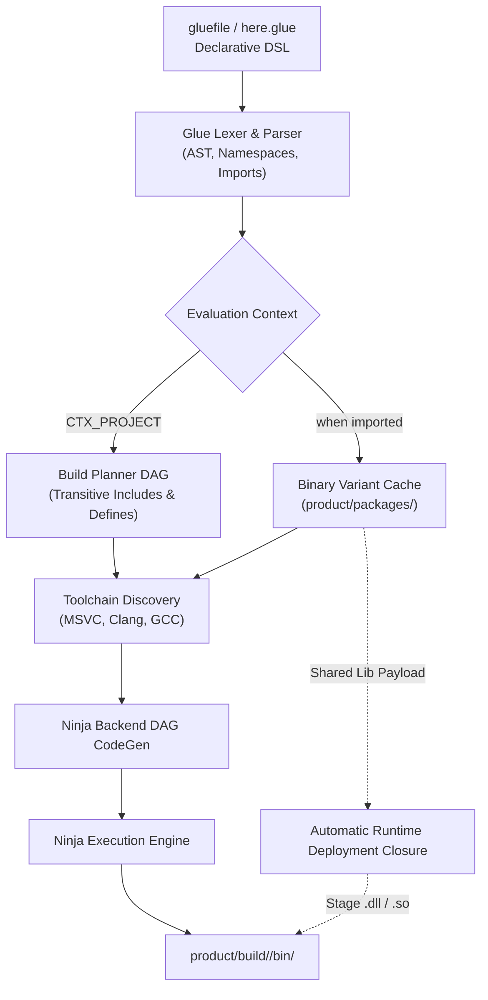

<div align="center">

# Glue

**A Unified Native Development System for C and C++**

*Declarative Build Graphs &bull; Binary-First Packages &bull; Automatic Runtime Deployment &bull; Reproducible Native Toolchains*

[]()
[](LICENSE)
[]()
[](https://ninja-build.org/)

</div>

---

Glue is an integrated native development platform for modern C and C++. It unifies **declarative target definition**, **native toolchain orchestration**, **deterministic graph planning**, and a **binary-first package ecosystem** behind a single cohesive command-line interface.

Instead of orchestrating fragile CMake scripts, manual `vcvarsall.bat` wrappers, brittle system package paths, and ad-hoc copy rules, Glue computes the exact target dependency DAG, resolves ABI-compatible binary packages, and delegates execution directly to high-performance build backends like [Ninja](https://ninja-build.org/).

---

## Key Architectural Innovations



### 1. Binary-First, Source-Capable Packages
Glue bridges the historic divide between source-only distributions (CMake/CPM) and precompiled systems (vcpkg/Conan). It inspects target ABI constraints, fetches precompiled binary variants matching the active host toolchain, verifies detached cryptographic digests, and falls back to deterministic source compilation only when an ABI variant is absent.

### 2. Declarative Context Separation (`when imported`)
Subproject pollution and leaky internal tests are eliminated at the grammar level:
```glue
when imported {
    return package()
}

// Active during local developer builds, bypassed when consumed as an import
static_lib.add(core).sources("src/*.c").include.public("include")
exec.add(test_suite).sources("tests/*.c").depends(core)
```

### 3. Automatic Runtime Deployment Closure
Glue eliminates **"DLL Hell"** and loader path crashes on native operating systems. When an executable consumes a shared library (`shared_lib`), Glue's runtime deployment closure automatically stages all transitive `.dll` or `.so` binaries directly into `product/build/<build-key>/bin/` alongside the linked executable, guaranteeing immediate zero-configuration execution via `glue run`.

### 4. Tripartite Identity Model
Glue mathematically partitions dependency identity across three independent dimensions:
1. **Package Coordinate:** Semantic upstream coordinate (`github@pinwhell/inih@0.5.0`).
2. **Variant ID:** Deterministic hash of target OS, CPU architecture, toolchain fingerprint, and compilation options.
3. **Content Digest:** Cryptographic SHA-256 tree digest computed over the relocatable payload.

### 5. Reproducible Locked Builds (`glue.lock`)
All resolved dependencies, git commits, variant identifiers, and content digests are serialized to `glue.lock`. In CI/CD pipelines, `glue build --locked` strictly guarantees deterministic zero-drift reproducibility.

---

## Directory Topology

Glue establishes an explicit separation between user sources, transient build intermediates, distributable package variants, and engine cache:

```text
my-project/
├── here.glue                         # Project entry manifest
├── glue.lock                         # Deterministic dependency lockfile
├── src/
│   └── main.c
├── include/
│   └── my_project.h
│
├── product/                          # Canonical project artifacts
│   ├── build/                        # Ephemeral build tree (safe to clean)
│   │   └── x86_64-windows/
│   │       ├── obj/                  # Intermediate .obj / .o files
│   │       └── bin/                  # Linked executables & staged DLLs
│   │
│   └── packages/                     # Relocatable, exported package products
│       └── acme/
│           └── fastmath/
│               └── 2.0.0/
│                   ├── gluefile      # Top-level package entry
│                   ├── metadata.json # Variant registry & digests
│                   └── variants/
│                       └── <variant-id>/
│                           ├── package.toml   # Variant ABI descriptors
│                           ├── content.sha256 # Detached cryptographic digest
│                           ├── gluefile       # Variant prebuilt bindings
│                           ├── include/       # Public relocatable headers
│                           ├── lib/           # Link-time interface (.lib / .so)
│                           └── bin/           # Runtime deployment payload (.dll)
│
└── .glue/                            # Ephemeral engine scratch cache
    └── cache/sources/github.com/     # Bare git checkouts & clone caches
```

---

## Quick Start

### Installation

Ensure Rust (1.75+) and [Ninja](https://ninja-build.org/) (1.11+) are installed.

```bash
git clone https://github.com/pinwhell/glue.git
cd glue
cargo build --release
```

Add `target/release` to your `PATH`, or install directly:
```bash
cargo install --path crates/glue-cli
```

### 1. Initialize a Project

```bash
mkdir hello-glue && cd hello-glue
glue init my_app
```

This creates a minimal `here.glue` and `main.cpp`:
```glue
exec.add(my_app).sources("main.cpp")
```

### 2. Build and Run

```bash
# Build the default target using the auto-discovered host toolchain (MSVC/Clang/GCC)
glue build

# Compile (if needed) and execute immediately
glue run
```

---

## Declarative Language Guide

### Target Definitions
Glue supports full first-class modeling of native software targets:

| Target Declaration | Semantics & Outputs |
|---|---|
| `exec.add(name)` | Linked executable binary (`.exe`, ELF binary, Mach-O). |
| `static_lib.add(name)` | Static library archive (`.lib`, `.a`). |
| `shared_lib.add(name)` | Shared library (`.dll`, `.so`, `.dylib`) and link-time import library. |
| `object_lib.add(name)` | Unlinked relocatable object collection. |
| `interface_lib.add(name)`| Header-only / Interface library exporting includes and preprocessor definitions. |

### Source File Discovery
Sources are resolved deterministically:
```glue
// 1. Explicit file declarations
exec.add(app).sources("src/main.c", "src/util.c")

// 2. Lexicographically sorted globbing
static_lib.add(core).sources("src/*.c", "src/platform/*.c")

// 3. Regular expression patterns (prefixed with regex:)
static_lib.add(math).sources("regex:src/core_v[0-9]+\\.c")
```

### Public & Private Property Propagation
Dependencies inherit compilation properties transitively:
```glue
namespace engine;

static_lib.add(renderer)
    .sources("src/render/*.cpp")
    .include.public("include")             // Exported to downstream consumers
    .include.private("src/internal")       // Private to this target
    .define("RENDERER_ENABLED")            // Public macro definition

exec.add(game)
    .sources("src/main.cpp")
    .depends(engine::renderer)             // Automatically inherits public include dirs & defines
```

### Remote GitHub Package Imports
Import third-party native libraries directly from GitHub:
```glue
import inih from github@pinwhell/inih version "^0.5.0"

namespace app;

exec.add(calc)
    .sources("src/main.c")
    .depends(inih::inih)
```
Glue clones the repository into `.glue/cache/sources/github.com/pinwhell/inih`, detects precompiled ABI variants, or triggers a source build automatically.

---

## Packaging Shared Libraries (`shared_lib`)

A core strength of Glue is its formal separation between the **Link-Time Interface** (`lib/`) and the **Runtime Deployment Payload** (`bin/` or `runtime/`).

### Producer (`fastmath/here.glue`):
```glue
when imported {
    return package()
}

namespace math;

shared_lib.add(fastmath)
    .sources("src/fastmath.c")
    .include.public("include")
    .define("FASTMATH_EXPORTS")
```

Produce the versioned, relocatable package:
```bash
glue package math::fastmath --version 2.0.0
```

Glue generates:
```text
product/packages/math/fastmath/2.0.0/variants/<variant-id>/
├── lib/fastmath.lib       # Windows Import Library (link-time symbols)
├── bin/fastmath.dll       # Windows Dynamic Link Library (runtime payload)
├── include/fastmath.h     # Public headers
└── gluefile               # Variant export bindings
```

### Consumer (`simulation/here.glue`):
```glue
import fastmath from "../fastmath"

namespace app;

exec.add(sim)
    .sources("src/main.c")
    .depends(fastmath::fastmath)
```

Run with automatic runtime staging:
```bash
glue run sim
```

```text
glue: Target artifact missing, building 'sim'...
glue: Staged runtime artifact: fastmath.dll
FastMath Multiply: 6 * 7 = 42
FastMath Power: 2 ^ 8 = 256
```
> [!NOTE]
> Glue passes `lib/fastmath.lib` to MSVC `link.exe` during linkage, and automatically copies `bin/fastmath.dll` into `product/build/x86_64-windows/bin/` so the dynamic loader finds it immediately with zero configuration.

---

## Executable Narratives

Glue includes self-verifying, reproducible narrative walkthroughs validating real-world engineering workflows:

| Narrative | Path | Description |
|---|---|---|
| **Shared Library Packaging** | [`narratives/shared-library-package`](narratives/shared-library-package/narrative.md) | Produces a shared library DLL/SO package and verifies automatic runtime deployment closure. |
| **GitHub Package Import** | [`narratives/github-package-import`](narratives/github-package-import/narrative.md) | Consumes remote C libraries from GitHub (`pinwhell/inih`) with lockfile generation. |
| **Locked Reproducible Builds** | [`narratives/locked-reproducible-builds`](narratives/locked-reproducible-builds/narrative.md) | Demonstrates deterministic compilation verification using `glue build --locked`. |
| **Package Producer** | [`narratives/package-producer`](narratives/package-producer/narrative.md) | Packages static libraries with relocatable headers, variant manifests, and SHA-256 digests. |
| **Package Consumer** | [`narratives/package-consumer`](narratives/package-consumer/narrative.md) | Consumes precompiled local packages with automatic fallback to source compilation. |

---

## Crates Architecture

Glue is engineered as a clean, highly decoupled Rust workspace:

| Crate | Responsibility |
|---|---|
| [`crates/glue-model`](crates/glue-model) | Core entity model (`Target`, `TargetKind`, `Project`, `BuildProfile`). |
| [`crates/glue-config`](crates/glue-config) | Lexer, recursive-descent parser, AST evaluator, and declarative dispatch. |
| [`crates/glue-toolchains`](crates/glue-toolchains) | Toolchain autodetection and command abstraction (MSVC, Clang, GCC, `vcvarsall`). |
| [`crates/glue-build`](crates/glue-build) | Dependency DAG planner, transitive include/define propagation, and deployment engine. |
| [`crates/glue-backend-ninja`](crates/glue-backend-ninja) | Ultra-fast Ninja build graph generation, implicit output handling, and execution. |
| [`crates/glue-packages`](crates/glue-packages) | Tripartite identity, package manifests (`package.toml`), and lockfiles (`glue.lock`). |
| [`crates/glue-resolver`](crates/glue-resolver) | Semantic version resolution and dependency graph unification. |
| [`crates/glue-platform-android`](crates/glue-platform-android) | Android NDK toolchain discovery and multi-ABI cross-compilation support. |
| [`crates/glue-cli`](crates/glue-cli) | Command-line interface, argument parsing, logging, and user UX. |

---

## Command Reference

```text
Usage: glue <COMMAND>

Commands:
  init     Initialize a new Glue project in the current directory
  build    Compile targets and verify dependencies (--locked for CI verification)
  run      Compile (if necessary) and execute an application target with full runtime closure
  package  Produce a relocatable binary package under product/packages/
  clean    Remove build tree (--all to purge packages and engine cache)
  explain  Inspect target compilation units, includes, defines, and dependencies
  graph    Emit Graphviz DOT graph visualizing the complete target build DAG
  help     Print command-line help
```

---

## Acknowledgments & Credits

Glue stands upon decades of open-source engineering excellence. We gratefully acknowledge:

- **[Evan Martin and the Ninja Authors](https://ninja-build.org/)** for building the definitive high-speed build execution backend.
- **[Chris Lattner and the LLVM Community](https://llvm.org/)** for state-of-the-art compiler and linker infrastructure.
- **[The Microsoft Visual C++ (MSVC) Team](https://visualstudio.microsoft.com/)** for Windows native toolchain standards.
- **[The Rust Language & Cargo Teams](https://www.rust-lang.org/)** for pioneering modern package ergonomics and memory-safe systems software.
- **[CMake (Kitware), Meson, and Bazel](https://cmake.org/)** for establishing the foundational concepts of native graph evaluation.

---

## License

Glue is licensed under the [MIT License](LICENSE).
