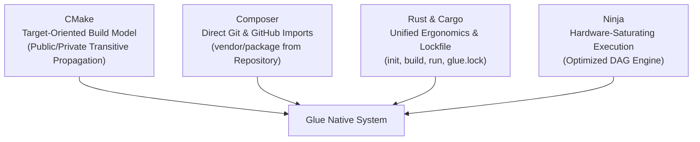

<div align="center">

# Glue

### The Native Development System & Package Manager C and C++ Always Deserved.

*The target modeling of **CMake** &bull; The Git-import simplicity of **Composer** &bull; The developer ergonomics of **Cargo** &bull; The raw speed of **Ninja***

[](LICENSE)
[]()
[]()
[]()

</div>

---

## What is Glue?

If you have ever used **Rust's Cargo**, **Composer in PHP**, or **Go**, you know what modern development ergonomics feel like: you create a project, declare your dependencies, hit `run`, and everything just works.

In C and C++, native development has remained fragmented for decades:
- Writing dozens of lines of arcane **CMake** macros and generator expressions just to link a library.
- Crashing at runtime with **"Missing DLL" errors** (`fastmath.dll was not found`) because the dynamic loader couldn't find your shared libraries.
- Manually cloning repositories or copy-pasting `.c` and `.h` files into `vendor/` directories because there is no simple way to pull a dependency from GitHub.
- Subprojects dragging 50 internal unit tests and linters into your build graph.
- Forgetting to initialize Visual Studio's `vcvarsall.bat` before compiling on Windows.

**Glue brings native C and C++ into the modern era.** It synthesizes the greatest breakthroughs in build systems and package management into a single, cohesive, blazing-fast native tool.

---

## Standing on the Shoulders of Giants: The DNA of Glue

Glue does not attempt to reinvent the wheel. Instead, it deliberately adopts the best conceptual breakthroughs across four decades of software tooling:



### 1. The Target-Oriented Model of CMake
[CMake](https://cmake.org/) (Kitware) revolutionized native software by introducing the **target model**: software should not be configured as raw compiler flags, but as discrete targets (`exec`, `static_lib`, `shared_lib`) with **public and private property propagation**. 
- **What Glue preserves:** First-class targets, transitive include propagation, and define inheritance.
- **What Glue fixes:** Eliminates CMake's 25-year-old scripting language, directory-scoping quirks, and endless boilerplate. Everything is clean and declarative.

### 2. The Git-Native Package Ergonomics of Composer
[Composer](https://getcomposer.org/) (Jordi Boggiano, Nils Adermann) transformed dependency management by proving that dependencies do not need to be trapped inside complex, centrally curated binary monopolies. Developers can declare dependencies directly from VCS and GitHub repositories (`vendor/package`), complete with semantic version constraints and commit tracking.
- **In Glue:** You import open-source C and C++ libraries directly from GitHub:
  ```glue
  import inih from github@pinwhell/inih version "^0.5.0"
  ```
  Glue clones, caches, links, and manages the dependency automatically.

### 3. The Developer Ergonomics of Rust's Cargo
[Cargo](https://doc.rust-lang.org/cargo/) proved that systems programming can be intuitive and delightful. One consistent CLI to initialize, build, and run projects with zero friction.
- **In Glue:** You enjoy the exact same workflow: `glue init` &rarr; `glue build` &rarr; `glue run`.
- **Reproducibility:** Glue introduces `glue.lock`, guaranteeing 100% deterministic, byte-for-byte reproducible builds across developer machines and CI/CD pipelines via `glue build --locked`.

### 4. The Raw Execution Speed of Ninja
[Ninja](https://ninja-build.org/) (Evan Martin, Google) is the gold standard for high-performance build execution.
- **In Glue:** Rather than running custom execution scripts, Glue translates your target graph into pristine, optimal Ninja build files. Your hardware cores are saturated at maximum parallel speed with instant incremental rebuilds.

---

## Solving C/C++'s Biggest Pain Points

| The Classic Pain Point | How Glue Solves It |
|---|---|
| **CMake Boilerplate Hell:** Writing 30 lines of `cmake_minimum_required`, `target_include_directories`, and `set_target_properties` just for two files. | **3 Declarative Lines:**<br>`exec.add(app).sources("src/*.c").include.public("include")`<br>Clean, readable, and intuitive. |
| **"Missing DLL" Runtime Crashes:** You compile an executable with a shared library, run it, and the OS crashes because `.dll` or `.so` isn't in your path. | **Automatic Runtime Deployment Closure:** Glue traverses all dependencies and automatically copies required `.dll` / `.so` payloads directly alongside your executable. `glue run` just works. |
| **No Simple Package Manager:** Manually configuring git submodules, wrestling with external package tools, or copy-pasting code into `vendor/`. | **Direct GitHub Imports (Composer-style):**<br>`import inih from github@pinwhell/inih`<br>Zero manual cloning or submodule headaches. |
| **Subproject Pollution:** Adding a library via `add_subdirectory()` drags in the author's internal tests and benchmarks into your build. | **Declarative Context Separation (`when imported`):** Libraries cleanly separate their internal developer tests from what they export to consumers. |
| **Manual Compiler Setup:** Forgetting to run Visual Studio's `vcvarsall.bat` before compiling on Windows. | **Automatic Toolchain Discovery:** Glue auto-detects installed compilers (MSVC Community, Clang, GCC) and sets up their environments automatically. |
| **Non-Reproducible Builds:** Builds breaking because a teammate has different library versions installed globally. | **Deterministic Lockfile (`glue.lock`):** Pinned versions, variant hashes, and SHA-256 digests ensure 100% reproducible builds. |

---

## Quick Start (60 Seconds)

### 1. Installation

Build the single self-contained `glue` binary with Rust:

```bash
git clone https://github.com/pinwhell/glue.git
cd glue
cargo install --path crates/glue-cli
```

*(Ensure [Ninja](https://ninja-build.org/) 1.11+ is installed on your system).*

### 2. Create Your First Project

```bash
mkdir my-app && cd my-app
glue init my_app
```

This generates a ready-to-run project:
- `here.glue`: Your declarative project configuration.
- `main.cpp`: A starter C++ application.

### 3. Run It

```bash
glue run
```

```text
glue: Successfully built artifact: product/build/x86_64-windows/bin/my_app.exe
Hello from Glue!
```

No build directories to create, no generator flags to pass, no environment variables to configure.

---

## Practical Examples That Feel Like Magic

### 1. Minimal Executable
`here.glue`:
```glue
namespace my_project;

exec.add(hello).sources("hello.c")
```

### 2. Library and Consumer Application (CMake Target Model Made Clean)
`here.glue`:
```glue
namespace math {
    static_lib.add(core)
        .sources("src/math/*.c")
        .include.public("include")
}

namespace app {
    exec.add(calculator)
        .sources("src/main.c")
        .depends(math::core)
}
```
> [!NOTE]
> `app` depends on `math::core`. Glue automatically forwards the public include directories and preprocessor definitions to `app` without any manual flag wiring.

### 3. Shared Libraries (DLLs / .so) with Zero Loader Errors
Building shared libraries on Windows and Linux is notoriously frustrating due to import libraries and runtime loader paths. In Glue, it's automatic:

**The Library (`fastmath`):**
```glue
when imported {
    return package()
}

namespace math;

shared_lib.add(fastmath)
    .sources("src/fastmath.c")
    .include.public("include")
    .define("FASTMATH_EXPORTS")
```

**The Consumer Application (`app`):**
```glue
import fastmath from "../fastmath"

exec.add(sim)
    .sources("src/main.c")
    .depends(fastmath::fastmath)
```

Run it with:
```bash
glue run sim
```

```text
glue: Target artifact missing, building 'sim'...
glue: Staged runtime artifact: fastmath.dll
FastMath Multiply: 6 * 7 = 42
FastMath Power: 2 ^ 8 = 256
```
Glue links against the import library (`.lib`), copies the dynamic payload (`.dll`) directly alongside `sim.exe`, and runs the program. **Zero missing DLL errors.**

### 4. Importing Packages from GitHub (Composer-Style Simplicity)
Import open-source C and C++ libraries directly from GitHub:

```glue
import inih from github@pinwhell/inih version "^0.5.0"

exec.add(config_reader)
    .sources("src/main.c")
    .depends(inih::inih)
```

Glue downloads the package, verifies its integrity, builds it with your active compiler, and locks the exact commit in `glue.lock`.

---

## The Cargo & Rust Parallels

If you know Cargo, Glue will feel like second nature:

| Cargo (Rust) | Glue (C/C++) | Purpose |
|---|---|---|
| `cargo new foo` | `glue init foo` | Initialize a new project workspace. |
| `cargo build` | `glue build` | Compile targets via high-speed Ninja DAG. |
| `cargo run` | `glue run` | Compile (if needed) and execute immediately. |
| `cargo build --locked` | `glue build --locked` | Strictly verify build against `glue.lock` without updating it (CI/CD). |
| `cargo clean` | `glue clean` | Clean transient build intermediates. |
| `Cargo.lock` | `glue.lock` | Cryptographic lockfile for 100% reproducible builds. |

---

## Predictable Directory Structure

Glue strictly separates your source code from transient build files and relocatable package products:

```text
my-project/
├── here.glue                 # Declarative project configuration
├── glue.lock                 # Deterministic dependency lockfile
├── src/                      # Source code
│   └── main.c
├── include/                  # Public headers
│   └── my_project.h
│
├── product/                  # Generated products
│   ├── build/                # Ephemeral build tree (safe to delete anytime)
│   │   └── x86_64-windows/
│   │       ├── obj/          # Intermediate .obj / .o files
│   │       └── bin/          # Linked executables & runtime DLLs
│   │
│   └── packages/             # Relocatable, versioned binary packages
│       └── my_project/0.1.0/
│
└── .glue/                    # Engine cache (bare git clones, fingerprints)
```

---

## Command Reference

```bash
# Initialize a new project
glue init [name]

# Build the project (or a specific target)
glue build [target]

# Build and run an executable target
glue run [target] [-- args forwarded to program...]

# Build strictly against glue.lock (fails if lockfile has drifted)
glue build --locked

# Package a library into a relocatable binary package
glue package <target> --version <version>

# Inspect targets, include paths, defines, and dependencies
glue explain [target]

# Export the build DAG in Graphviz DOT format
glue graph

# Clean build artifacts
glue clean         # Removes product/build/
glue clean --all   # Purges product/ and .glue/ cache
```

---

## Self-Verifying Narratives

Glue's features are thoroughly tested via self-verifying, reproducible narrative walkthroughs:

- [**Shared Library Packaging & Deployment:**](narratives/shared-library-package/narrative.md) Packaging a shared DLL/SO and consuming it with automatic runtime deployment.
- [**GitHub Package Import:**](narratives/github-package-import/narrative.md) Importing a remote C library from GitHub (`pinwhell/inih`).
- [**Locked Reproducible Builds:**](narratives/locked-reproducible-builds/narrative.md) Frozen builds and verification using `glue.lock`.
- [**Binary Package Production & Consumption:**](narratives/package-producer/narrative.md) Creating relocatable binary packages with detached SHA-256 digests.

---

## Acknowledgments & Credits

Glue is a lightweight orchestration layer built on the shoulders of giants. All credit for the underlying execution, compilation, and dependency technology belongs to:

- **[CMake & Kitware](https://cmake.org/):** For pioneering modern native target-oriented modeling and transitive property propagation.
- **[Composer (Jordi Boggiano, Nils Adermann)](https://getcomposer.org/):** For demonstrating that dependencies can be pulled cleanly and directly from Git and GitHub repositories without centralized gatekeeping.
- **[The Rust Language & Cargo Teams](https://www.rust-lang.org/):** For establishing the gold standard of systems programming ergonomics, lockfiles, and developer happiness.
- **[Evan Martin & the Ninja Maintainers](https://ninja-build.org/):** For creating the definitive high-speed build execution engine.
- **[LLVM / Clang](https://llvm.org/) & [Microsoft MSVC](https://visualstudio.microsoft.com/):** For decades of compiler engineering, linkers, and native toolchain standards.

---

## License

Glue is distributed under the [MIT License](LICENSE).
