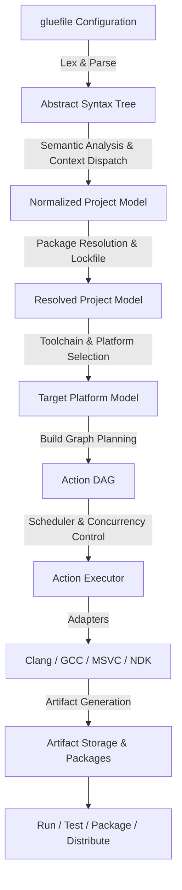
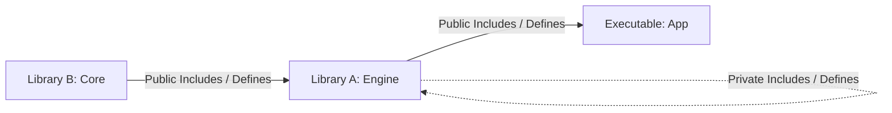
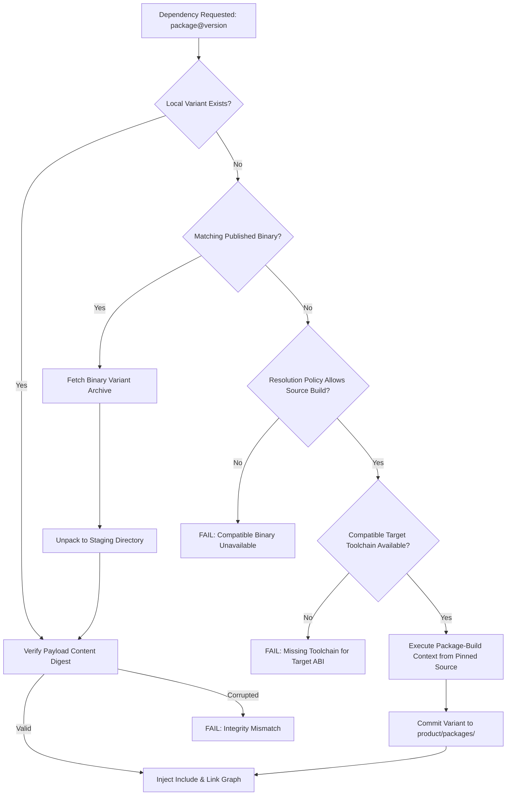
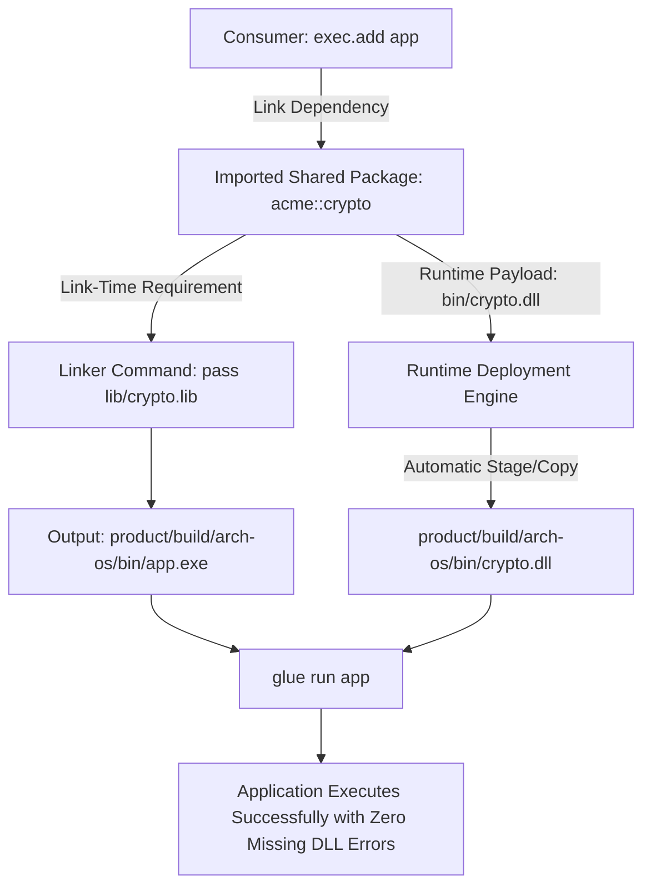
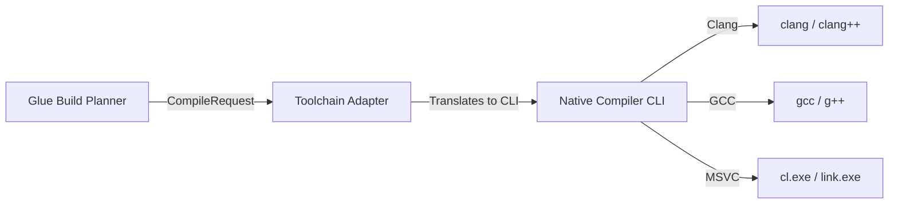

# Glue
## A Unified Native Development System

**Architecture & Design Specification**  
**Document Version:** 1.0  
**Status:** Canonical Architectural Specification  
**Primary Scope:** C, C++, native build orchestration, binary-first package management, multi-platform toolchain abstraction, cross-compilation, and ABI compatibility verification. Rust integration is specified as an architecturally planned extension.

---

# 1. Abstract

Glue is a native development system designed to unify project configuration, package management, native compilation, linking, and runtime execution behind a single, coherent, and deterministic interface.

For decades, the native C and C++ ecosystems have suffered from fragmented tooling. Developers are forced to manually orchestrate disconnected tools: build systems (Make, CMake, Meson), package managers (vcpkg, Conan, system package managers), compiler frontends (GCC, Clang, MSVC), and platform SDKs (Android NDK, Windows SDK, Apple SDKs). This fragmentation introduces brittle configuration scripts, hidden environment dependencies, unverified ABI incompatibilities, and non-reproducible builds.

Glue addresses this challenge by establishing a unified, target-oriented model that combines the intuitive dependency management experience of modern package ecosystems with the rigorous low-level control demanded by systems software. Glue provides:
- A compact, declarative configuration language (`gluefile`) with deterministic parsing and explicit scoping.
- A **Binary-First, Source-Capable** package lifecycle that automatically leverages precompiled binary variants while preserving deterministic source-build fallback.
- A tripartite identity model separating logical Package Coordinates, normalized Variant IDs, and cryptographic Content Digests.
- A directed acyclic graph (DAG) build engine driven by content-based action fingerprinting and incremental invalidation.
- A capability-oriented toolchain abstraction isolating native compiler idiosyncrasies from the core engine.
- Explicit platform and ABI verification eliminating silent runtime incompatibilities.

Glue does not attempt to rewrite battle-tested compilers, linkers, or platform sysroots. Instead, it acts as an authoritative native coordinator—governed by the fundamental principle:

$$\text{Project Intent} \xrightarrow{\text{Parse \& Validate}} \text{Target Model} \xrightarrow{\text{Resolve}} \text{Action DAG} \xrightarrow{\text{Execute}} \text{Verified Artifacts}$$

---

# 2. Vision and Scope

## 2.1. Product Vision

The primary mission of Glue is to make native software engineering intuitive, predictable, and robust across all development phases—from initial prototyping to enterprise-grade, multi-architecture distribution.

A minimal native project requires only a single, expressive declaration:

```glue
exec.add(hello).sources("hello.c")
```

Execution is invoked with zero manual compiler invocations:

```bash
glue run hello
```

Glue discovers the local toolchain, constructs the compilation and link action graph, executes the actions, caches the outputs, and runs the resulting executable.

As the software evolves into complex, multi-package architectures, the mental model remains uniform:

```glue
import inih from github@pinwhell/inih version "^0.5.0"

exec.add(app)
    .sources("src/*.cpp")
    .depends(inih)
```

The consumer expresses *what* dependencies and targets exist; Glue deterministically determines *how* to acquire, verify, build, and link them.

## 2.2. What Glue Is

Glue is an **integrated native development system**, combining:
1. **A Declarative Configuration Language:** High-level project specifications without imperative scripting overhead.
2. **A Binary-First Package Manager:** Multi-variant package acquisition, cryptographic integrity verification, and automatic source fallback.
3. **An Incremental Build Engine:** Action DAG execution with content-hashed fingerprints, dynamic header scanning, and parallel execution.
4. **A Multi-Platform Toolchain Coordinator:** Universal abstraction over Clang, GCC, MSVC, and cross-compilation toolchains (e.g., Android NDK).
5. **A Runtime and Deployment Orchestrator:** Separation of compile-time, link-time, and runtime deployment requirements (such as DLL and shared library tracking).

## 2.3. What Glue Is Not

To maintain architectural integrity and lean execution, Glue explicitly defines its non-goals:
- **Glue is not a compiler or linker:** It coordinates industry-standard compilers (LLVM/Clang, GCC, MSVC/LINK).
- **Glue is not a general-purpose programming language interpreter:** Configuration files are declarative specifications, not Turing-complete scripts.
- **Glue is not an OS container or full virtualization engine:** It manages build actions and native artifacts, delegating operating-system virtualization to dedicated systems when required.
- **Glue is not an application store packager:** It outputs relocatable native libraries and executables; platform packaging formats (such as Android APKs/AABs or macOS application bundles) reside at the integration boundary.

---

# 3. Core Design Principles

### 3.1. One Coherent Project Model
All entities—targets, dependencies, source sets, compile flags, platform requirements, and binary artifacts—are represented in a unified semantic model. Subsystems operate on this shared representation without semantic drift.

### 3.2. Simple by Default, Explicit When Necessary
A single executable requires only one line of configuration. However, when complex requirements arise—such as custom sysroots, specific C++ ABI variants, or static runtime linkages—Glue provides explicit, first-class configuration mechanisms. Glue never conceals meaningful decisions behind opaque heuristics.

### 3.3. Binary-First, Source-Capable
Packages prioritize binary distribution for fast, reliable consumption across development environments, while maintaining strict, automated source compilation fallback when matching binaries are absent.

### 3.4. Absolute Separation of Identities
Glue enforces three distinct identity dimensions:
- **Package Coordinate:** Semantic, human-readable identity (`<namespace>/<name>@<version>`).
- **Variant ID:** Normalized configuration hash defining target platform, ABI, toolchain baseline, and feature options.
- **Content Digest:** Cryptographic checksum (SHA-256) verifying the physical integrity of the artifact payload.

### 3.5. Reproducibility by Design
Every build decision is governed by explicit inputs: source revisions, toolchain versions, platform triples, and effective flags. Build actions are indexed by cryptographic fingerprints. A locked configuration (`glue.lock`) guarantees identical dependency graphs across distinct environments.

### 3.6. Toolchains as Adapters
Compilers and linkers are modeled as interchangeable capability providers. Toolchain-specific command-line flags and idiosyncrasies are encapsulated within modular adapters, preserving engine neutrality.

### 3.7. Relocatable and Self-Contained Artifacts
Published package products are completely relocatable. Packages must never embed host-specific absolute paths. A package produced on machine A must be unpackable and consumable on machine B without path mutations.

### 3.8. Correctness Before Optimization
A fast build that produces an incorrect binary is fundamentally defective. Glue enforces rigorous invalidation, conservative ABI checking, and fail-stop error handling before optimizing for concurrency and caching.

---

# 4. System Architecture

Glue is architected as an unidirectional transformation pipeline between strongly-typed intermediate representations:



## 4.1. Core Architectural Subsystems

| Subsystem | Responsibilities | Key Invariants |
|---|---|---|
| **Configuration Frontend** | Tokenization, grammar parsing, AST construction, and static semantic validation. | Pure functional transformation; syntax is decoupled from semantic execution. |
| **Context Dispatcher** | Evaluates file context: *Project Context*, *Imported Context*, or *Package-Build Context*. | Declarative routing; prevents cyclic self-referencing during source fallback. |
| **Package Resolver** | Graph resolution, SAT-based version constraint solving, and lockfile synchronization. | Deterministic resolution; pinned source revisions and strict integrity checks. |
| **Artifact & Variant Engine** | Binary variant matching, ABI matrix evaluation, payload extraction, and staging. | Variant ID matching; physical payload verification via detached SHA-256 digests. |
| **Toolchain Subsystem** | Host environment discovery, cross-toolchain instantiation, and capability detection. | Toolchain-neutral operation model (`CompileRequest`, `LinkRequest`). |
| **Build Planner & DAG** | Transforms targets into atomic compilation, generation, and linkage actions. | Strict DAG; cycle detection; content-hash action fingerprinting. |
| **Action Scheduler & Executor**| Concurrency-controlled execution, dynamic dependency injection, and process isolation. | Non-zero exit code propagation; atomic generation of target outputs. |
| **Storage & Cache Manager** | Partitions `product/build`, `product/packages`, and `.glue/` cache. | Clean boundaries; package products survive build directory clean operations. |

---

# 5. Project Configuration Language (`gluefile`)

Glue provides a clean, declarative configuration grammar designed specifically for native systems development.

## 5.1. Syntax and Target Declarations

A `gluefile` contains target declarations, package imports, and scoping directives:

```glue
// Declaring a static library with explicit include visibility
static_lib.add(crypto)
    .sources("src/*.c")
    .include.public("include")
    .include.private("src/internal")
    .define("CRYPTO_VERSION", "2.1.0")

// Declaring an executable dependent on the library
exec.add(server)
    .sources("src/main.cpp", "src/server.cpp")
    .depends(crypto)
    .options.optimize("speed")
```

### Supported Target Archetypes

| Target Type | Primary Output | Compilation Semantics | Linkage Semantics |
|---|---|---|---|
| `exec` | Executable binary (`.exe`, ELF binary, Mach-O) | Compiles all local sources to object files. | Links objects, resolved static archives, and dynamic import libraries. |
| `static_lib` | Static library archive (`.a`, `.lib`) | Compiles sources into position-independent or target object files. | Archives objects using `ar`, `llvm-ar`, or `lib.exe`. |
| `shared_lib` | Shared library (`.so`, `.dll`, `.dylib`) | Compiles sources with position-independent code (`-fPIC` / dllexport). | Links shared object; produces import library (`.lib`) on Windows. |
| `object_lib` | Object file collection | Compiles sources to relocatable objects. | No linkage; propagates raw object files directly to consuming targets. |
| `interface_lib`| Header-only / Interface | No compilation actions. | Transmit public includes, definitions, and interface flags to consumers. |
| `custom` | Synthetic / Generated artifacts | Executes custom generators or tooling. | Outputs feed downstream compilation actions as declared inputs. |

## 5.2. Source Discovery: Explicit, Globbing, and Regular Expressions

Glue enforces deterministic source evaluation. Sources may be declared explicitly or via patterns:

### 1. Explicit Declarations
```glue
exec.add(app).sources("src/main.c", "src/util.c")
```

### 2. Globbing Patterns
```glue
static_lib.add(core).sources("src/*.c", "src/platform/*.c")
```
- Glob patterns (`*`, `**`, `?`) are evaluated relative to the project root directory during project configuration.
- Matched file lists are sorted lexicographically by canonical path to guarantee cross-platform build reproducibility.
- If a glob pattern fails to match any candidate file, Glue raises an early diagnostic error, preventing silent compilation omissions.

### 3. Regular Expression Patterns
```glue
exec.add(app).sources("regex:src/core_v[0-9]+\\.c", "regex:src/module_.*\\.cpp")
```
- Regex patterns are indicated by the `regex:` prefix.
- The engine discovers candidate files within the target directory path and filters filenames against the compiled regular expression.
- Matched paths are sorted deterministically in lexicographical order. Empty matches trigger an early diagnostic.

## 5.3. Include Visibility and Property Propagation

Glue follows a transitive property propagation model across target dependencies:



- **`include.public(path)`**: Exported to any downstream target depending on this target.
- **`include.private(path)`**: Accessible only during the compilation of this target's own sources.
- **`define(key, value)`**: Compiler preprocessor definitions with public/private scoping.
- **`depends(...)`**: Links target artifacts and inherits public compile properties transitively.

## 5.4. Namespaces and Target Qualification

Namespaces prevent naming collisions across subprojects and imported third-party packages.

### Global File Namespace
```glue
namespace openssl;

static_lib.add(crypto).sources("src/crypto.c").include.public("include")
static_lib.add(ssl).sources("src/ssl.c").depends(crypto)
```

### Block Scoped Namespaces
```glue
namespace engine {
    static_lib.add(renderer).sources("src/render/*.cpp")
}
```

### Target Qualification Syntax
Consumers access namespaced targets via double-colon (`::`) qualification:
```glue
import openssl from github@openssl/openssl version "^3.0.0"

exec.add(gateway)
    .sources("src/main.cpp")
    .depends(openssl::ssl)
```

## 5.5. Evaluation Contexts and Declarative Import Dispatch

A central architectural innovation of Glue is the formal separation of project evaluation contexts via declarative dispatch:

```glue
when imported {
    return package()
}

// =========================================================================
// Developer Workspace Declarations (Active only in Project Context)
// =========================================================================
static_lib.add(core).sources("src/*.c").include.public("include")
exec.add(run_tests).sources("tests/*.c").depends(core)
```

### Operational Semantics of Context Transitions

```mermaid
stateDiagram-v2
    [*] --> EvaluationDispatch
    
    EvaluationDispatch --> ProjectContext: CLI invoked locally (glue build/run/package)
    EvaluationDispatch --> ImportedContext: Project evaluated as dependency (import foo)
    EvaluationDispatch --> PackageBuildContext: Source fallback build triggered
    
    ProjectContext --> EvaluateFullTree: Ignore 'when imported' branch; evaluate targets & tests
    ImportedContext --> RouteToPackageProduct: 'when imported' triggers return package()
    PackageBuildContext --> EvaluateSourceRecipe: Bypass 'when imported'; compile package targets
```



1. **Project Context (`CTX_PROJECT`):**
   - Active when a developer executes `glue build`, `glue test`, or `glue run` inside their repository checkout.
   - The `when imported` block is statically recognized but its branch is not taken. The full `gluefile` is evaluated, enabling developers to build internal test suites, examples, and development targets.
2. **Imported Context (`CTX_IMPORTED`):**
   - Active when Glue evaluates this project as an imported dependency from another project.
   - The engine halts evaluation at `when imported { return package() }`. It immediately routes consumption to the precompiled, relocatable package manifest at `product/packages/<namespace>/<name>/<version>/gluefile`.
   - The consumer never parses the producer's internal test targets or local developer build actions.
3. **Package-Build Context (`CTX_PACKAGE_BUILD`):**
   - Active when a consumer requests a package variant that is not precompiled, initiating a **source fallback build**.
   - The engine explicitly enters the package-build context, which **disables the `when imported` branch**.
   - Glue compiles only the declared package export targets directly from source, outputting the resulting variant into `product/packages/`, eliminating infinite recursion.

---

# 6. Binary-First Package Management System

Glue's package manager combines binary distribution speed with source compilation resilience.



## 6.1. Tripartite Identity Model

Traditional package systems frequently conflate identity, compatibility, and verification into a single hash. Glue models them as three mathematically independent dimensions:

```text
┌────────────────────────────────────────────────────────────────────────┐
│                        TRIPARTITE IDENTITY MODEL                       │
├────────────────────────────────┬───────────────────────────────────────┤
│ 1. Package Coordinate          │ github@pinwhell/inih@0.5.0            │
│    (Logical / Upstream)        │ - Pinned source repository revision   │
│                                │ - Semantic version & namespace        │
├────────────────────────────────┼───────────────────────────────────────┤
│ 2. Variant ID                  │ var_x86_64_linux_gnu_opt_fpic_a3f9    │
│    (Compatibility Matrix)      │ - Target OS, Arch, ABI, Sysroot       │
│                                │ - Compiler baseline & C++ runtime     │
│                                │ - Feature flags & linkage mode        │
├────────────────────────────────┼───────────────────────────────────────┤
│ 3. Content Digest              │ sha256:e3b0c44298fc1c149afbf4c8996fb92 │
│    (Physical Integrity)        │ - Detached cryptographic hash of the  │
│                                │   canonical payload directory tree    │
└────────────────────────────────┴───────────────────────────────────────┘
```

1. **Package Coordinate:** Semantic identity (`<provider>@<namespace>/<name>@<version>`). Identifies the source codebase and immutable commit revision.
2. **Variant ID:** A deterministic hash of the normalized compilation parameters:
   $$\text{Variant ID} = H(\text{TargetTriple} \parallel \text{ABI} \parallel \text{RuntimeBaseline} \parallel \text{ToolchainClass} \parallel \text{Linkage} \parallel \text{Options})$$
3. **Content Digest:** Cryptographic SHA-256 digest computed over the canonicalized file tree of the extracted package variant.

## 6.2. Linkage Semantics and C-Runtime Boundaries

Native linking involves subtle platform constraints that must be modeled explicitly:

### Static Archives (`.a`, `.lib`)
- A static archive is a container of object files.
- **Invariance:** Static linking does **not** guarantee universal portability. A `.a` library compiled against glibc 2.38 cannot link on a system running glibc 2.31.
- On Windows, a `.lib` file can be an **archive of static objects** or an **import library** referencing an external DLL. Glue's package metadata explicitly tags the role of each library file.

### Shared Objects (`.so`, `.dll`, `.dylib`)
Shared libraries require two distinct models:
1. **Link-Time Model:** Supplies symbols to the linker (e.g., direct `.so` linking on Linux; import `.lib` linking on Windows).
2. **Runtime Deployment Model:** Specifies how the dynamic runtime payload is discovered by the operating system loader:
   - **Windows:** Deployment of `.dll` binaries alongside the consuming executable in `product/build/<key>/bin/` or explicit PATH configuration.
   - **Linux / ELF:** Setting `DT_RUNPATH` with `$ORIGIN/../lib` to ensure fully relocatable runtime execution without global root installation.
   - **macOS / Mach-O:** Configuring `@rpath` and `@loader_path` load commands.

## 6.3. Binary Variant Compatibility Matrix

When evaluating whether a candidate precompiled binary variant can be consumed by the active target build, Glue validates every dimension of the compatibility matrix:

| Dimension | Checked Properties | Invalidation / Rejection Condition |
|---|---|---|
| **Architecture & OS** | CPU (`x86_64`, `aarch64`, `armv7`), OS (`linux`, `windows`, `android`, `darwin`). | Any difference in architecture or OS immediately rejects the variant. |
| **ABI & Calling Convention**| EABI, HardFloat/SoftFloat, Windows x64 ABI, Android NDK ABI (`arm64-v8a`). | Mismatch in calling convention or ABI level. |
| **C Runtime (CRT)** | MSVC (`/MD`, `/MT`, `/MDd`, `/MTd`), Linux libc (glibc version baseline vs musl). | Incompatible CRT linkage causes memory allocator corruption and is strictly rejected. |
| **C++ Standard Library**| `libstdc++` (Dual ABI `_GLIBCXX_USE_CXX11_ABI`), `libc++`, MSVC STL toolset. | Mixing conflicting C++ standard library runtimes is rejected. |
| **Relocation Model** | Position Independent Code (`-fPIC` / `-fPIE`) vs static non-PIC. | Non-PIC objects cannot be linked into shared libraries. |

## 6.4. Resolution Policies

Consumers control package acquisition behavior using resolution policies:

```bash
glue build --package-policy prefer-binary   # (Default) Binary first, fallback to source
glue build --package-policy build-missing   # Force source build if binary is absent
glue build --package-policy source-only     # Never download precompiled binaries
glue build --package-policy binary-only     # Strict: fail if no precompiled variant matches
```

> [!CAUTION]
> If a downloaded binary fails its cryptographic Content Digest check or has an ABI mismatch, Glue terminates with an integrity error. **It never silently falls back to source compilation on integrity failures**, as this could mask supply-chain tampering.

---

# 7. Package Production and Directory Topology

Glue establishes an explicit boundary between transient build intermediates, distributable package products, and the local engine cache.

```text
my-project/
├── gluefile                          # Project configuration root
├── product/
│   ├── build/                        # Local project build tree
│   │   └── x86_64-linux-release/
│   │       ├── obj/                  # Intermediate .o / .obj files
│   │       └── bin/                  # Linked executables & local outputs
│   │
│   └── packages/                     # Relocatable, exported package products
│       └── pinwhell/
│           └── inih/
│               └── 0.5.0/
│                   ├── gluefile      # Package entry manifest (exported targets)
│                   ├── metadata.json # Available variants index & signatures
│                   └── variants/
│                       ├── x86_64-linux-gnu-static/
│                       │   ├── include/     # Relocatable public headers
│                       │   │   └── ini.h
│                       │   ├── lib/         # Relocatable libraries
│                       │   │   └── libinih.a
│                       │   └── variant.json # Variant compatibility specification
│                       │
│                       └── x86_64-windows-msvc-static/
│                           ├── include/
│                           │   └── ini.h
│                           ├── lib/
│                           │   └── inih.lib
│                           └── variant.json
│
└── .glue/                            # Ephemeral engine scratch cache (safe to rm -rf)
    ├── downloads/                    # Git bare checkouts and archives
    ├── planner/                      # Cached action DAG state
    └── fingerprints/                 # Action execution cache database
```

## 7.1. The `glue package` Command

Producing a package is an explicit, verified operation:

```bash
glue package
# Or targeting a specific cross-compilation platform:
glue package --target android-arm64
```

### Packaging Pipeline Stages
1. **Target Compilation:** Builds the exportable target under `CTX_PACKAGE_BUILD`.
2. **Artifact Staging:** Copies declared public headers, compiled archives, and import libraries into an isolated staging root: `.glue/staging/<uuid>/`.
3. **Relocatability Audit:** Scans all staged files to ensure no hardcoded producer paths exist in headers or generated metadata.
4. **Digest Calculation:** Computes the canonical SHA-256 tree digest over the staged payload.
5. **Atomic Commit:** Renames `.glue/staging/<uuid>/` to `product/packages/<ns>/<name>/<ver>/variants/<var-id>/`.

## 7.2. Producing Shared Library Packages (`shared_lib`)

While static packages encapsulate object files into a single link-time archive, producing a **shared library package** (`shared_lib`) requires modeling a fundamental duality: the **Link-Time Interface** versus the **Runtime Deployment Payload**.

Native operating systems treat shared libraries through distinct link-time and loader mechanisms:

| Platform | Link-Time Interface (`lib/`) | Runtime Payload (`bin/` or `runtime/`) | Loader Discovery Mechanism |
|---|---|---|---|
| **Windows (PE/COFF)** | Import Library (`.lib` with `.idata` records) | Dynamic Link Library (`.dll`) | Executable directory, `PATH`, Windows System directories |
| **Linux (ELF)** | Shared Object (`.so` symlink or binary) | Versioned Shared Object (`.so.<version>`) | `DT_RUNPATH` / `DT_RPATH` with `$ORIGIN`, `LD_LIBRARY_PATH` |
| **macOS (Mach-O)** | Dynamic Library (`.dylib` symlink or binary) | Versioned Dynamic Library (`.<version>.dylib`) | `@rpath`, `@executable_path`, `@loader_path` |
| **Android (ELF/NDK)** | Shared Object (`.so`) | ABI-partitioned Shared Object (`.so`) | `System.loadLibrary()`, APK `lib/<abi>/` extraction |

### 7.2.1. Shared Package Variant Topology

A packaged shared library variant under `product/packages/<namespace>/<name>/<version>/variants/<variant-id>/` is organized into distinct functional directories:

```text
product/packages/acme/crypto/1.2.0/variants/x86_64-windows-msvc-shared/
├── gluefile              # Exported target declaration with linkage and runtime bindings
├── package.toml          # Variant compatibility, ABI contract, and payload descriptors
├── content.sha256        # Detached SHA-256 tree digest covering all payload files
├── include/              # Relocatable public headers
│   └── crypto.h
├── lib/                  # Link-Time Interface
│   └── crypto.lib        # PE Import Library (not a static archive)
└── bin/                  # Runtime Deployment Payload
    └── crypto.dll        # Dynamic Link Library loaded by OS PE loader
```

For ELF platforms (Linux), the topology unifies or symlinks the link interface to the versioned runtime artifact while establishing an embedded `SONAME`:

```text
product/packages/acme/crypto/1.2.0/variants/x86_64-linux-gnu-shared/
├── gluefile
├── package.toml
├── content.sha256
├── include/
│   └── crypto.h
├── lib/                  # Link-time interface (linker input)
│   ├── libcrypto.so -> libcrypto.so.1.2.0
│   └── libcrypto.so.1 -> libcrypto.so.1.2.0
└── runtime/              # Relocatable runtime payload
    └── libcrypto.so.1.2.0 # Contains DT_SONAME = "libcrypto.so.1"
```

### 7.2.2. The Shared Packaging Pipeline (`glue package`)

When `glue package` is executed against a `shared_lib` target:

1. **Compilation with Position-Independence:** All object files are compiled with Position-Independent Code flags (`-fPIC` on Linux/macOS; Windows COFF code by default).
2. **Symbol Visibility & Export Strategy:**
   - On Windows: The compiler and linker are instructed to emit both the dynamic library (`.dll`) and the import library (`.lib`). The package recipe or source code declares exported symbols via platform macros (e.g., `__declspec(dllexport)` on Windows or `__attribute__((visibility("default")))` on GCC/Clang).
   - On Linux/macOS: Hidden visibility by default (`-fvisibility=hidden`) is encouraged, and the linker sets the immutable soname (`-Wl,-soname,lib<name>.so.<major>`).
3. **Partitioned Staging:**
   - Public headers are staged to `include/`.
   - Linker inputs (import libraries `.lib`, or linker symlinks `.so`) are staged to `lib/`.
   - Dynamic binaries (`.dll`, `.so.<ver>`, `.dylib`) are staged to `bin/` (Windows) or `runtime/` (Unix).
4. **Relocatability and Path Auditing:**
   - Scans that the shared library does not hardcode producer build paths in `DT_RPATH` / `DT_RUNPATH`.
   - On macOS, ensures install names use `@rpath/lib<name>.dylib`.
5. **Variant Gluefile Generation:**
   Emits a variant-level `gluefile` that explicitly binds both the link-time artifact and the runtime deployment payload:
   ```glue
   namespace acme;

   shared_lib.add(crypto)
       .prebuilt("lib/crypto.lib")
       .runtime("bin/crypto.dll")
       .include.public("include")
   ```
6. **Canonical Digest Calculation:**
   The cryptographic Content Digest is computed across the entire staged variant tree (headers, import libraries, runtime payloads, and manifest metadata).

### 7.2.3. The Automatic Runtime Deployment Closure

A central failure of native C/C++ dependency management is the "DLL Hell" or missing shared library problem at runtime: a project compiles and links successfully, but crashes upon execution because the dynamic loader cannot find the shared library.

Glue eliminates this failure through **Automatic Runtime Deployment**:



1. **Link Step:** The build planner supplies the link-time artifact (`lib/crypto.lib` or `lib/libcrypto.so`) to the link action of the consuming target.
2. **Deployment Step:** The build executor traverses the target's transitive dependency closure. For every resolved `shared_lib`, Glue automatically stages the declared `runtime` payloads directly into the consumer's executable directory (`product/build/<build-key>/bin/` on Windows) or establishes relocatable runtime search paths (`-Wl,-rpath,'$ORIGIN/../lib'` on ELF, `@loader_path` on Mach-O).
3. **Seamless Execution (`glue run`):** When `glue run` launches the binary, the dynamic loader finds all transitive shared dependencies immediately in the local execution context without modifying system directories or environment variables.

---

# 8. Dependency Lockfile and Reproducibility (`glue.lock`)

Deterministic builds require locking all inputs. Glue generates and honors a comprehensive, machine-readable lockfile (`glue.lock`):

```toml
# Glue Dependency Lockfile — Canonical Format v1
version = 1

[[package]]
coordinate = "github@pinwhell/inih@0.5.0"
source_revision = "7a8b3f4c2e1d0a9b8c7d6e5f4a3b2c1d0e9f8a7b"
resolved_variant = "x86_64-linux-gnu-opt-static"
variant_id = "var_a91f3c88b02e"
content_digest = "sha256:7b9260c6d59e35d259c735d46c646b9a9b7f5f2e8f192b0e6c5a3d7b8e1f0a2d"
delivery_mode = "binary_download" # or "source_built"

[package.effective_options]
linkage = "static"
optimization = "speed"
crt = "glibc-2.31"
```

### Frozen Builds (`--locked`)
In CI/CD pipelines, builds must be strictly verified against the lockfile:
```bash
glue build --locked
```
If `gluefile` contains dependencies or constraints that deviate from `glue.lock`, the build halts immediately with a clear diagnostic instead of silently updating the lockfile.

---

# 9. Build Engine and Incremental Graph Execution

Glue represents all operations as a Directed Acyclic Graph (DAG) of atomic `BuildAction` nodes.

## 9.1. The `BuildAction` Model

Each node in the build graph is fully described by an immutable data structure:

```rust
pub struct BuildAction {
    pub id: ActionId,
    pub operation: OperationKind, // CompileC, CompileCpp, Archive, LinkExec, Custom
    pub inputs: Vec<PathBuf>,
    pub outputs: Vec<PathBuf>,
    pub dependencies: Vec<ActionId>,
    pub toolchain: ToolchainRef,
    pub working_dir: PathBuf,
    pub environment: BTreeMap<String, String>,
    pub effective_flags: Vec<String>,
}
```

## 9.2. Content Fingerprinting & Invalidation

Glue avoids rebuilding unchanged targets by calculating an invariant action fingerprint:

$$\text{Fingerprint} = \text{SHA256}\Big(\sum H(\text{Input File Contents}) \parallel H(\text{Compiler Binary \& Version}) \parallel \sum \text{Flags} \parallel \sum \text{Environment Vars}\Big)$$

- **Source File Hashing:** Uses fast Blake3 or SHA-256 hashing of file contents. File modification timestamps (`mtime`) serve purely as an early filter; if `mtime` changed but contents are identical, no recompilation occurs.
- **Dynamic Header Dependency Tracking:**
  - For Clang and GCC, Glue injects `-MMD -MF <depfile>` flags to capture included headers (`.h`).
  - For MSVC, Glue parses `/showIncludes` output from compiler stdout.
  - All discovered header paths are added to the action's dynamic input set for subsequent fingerprint evaluations.

## 9.3. Parallel Concurrency Control

The build scheduler maintains a topological sort of the action DAG:
- Actions with satisfied dependencies enter the ready queue.
- Concurrency defaults to the host machine's logical CPU count ($N$).
- High-memory operations (such as final whole-program LTO linking) can be assigned resource weights to prevent out-of-memory thrashing.

---

# 10. Toolchain and Compiler Architecture

Glue interacts with native compilers via clean, capability-driven toolchain adapters:



## 10.1. Structured Request Interfaces

The build engine never formats raw shell command strings directly. It dispatches structured requests:

### `CompileRequest`
- `source_file`: Path to the source file.
- `output_file`: Target object file (`.o` / `.obj`).
- `language`: `C89`, `C99`, `C11`, `C17`, `Cxx11`, `Cxx14`, `Cxx17`, `Cxx20`, `Cxx23`.
- `include_paths`: List of public, private, and system search directories.
- `defines`: Key-value pairs for preprocessor definitions.
- `optimization`: `Debug`, `ReleaseFast`, `ReleaseSmall`, `ReleaseSafe`.
- `pic_mode`: Boolean indicating Position Independent Code requirements.

### `LinkRequest`
- `output_file`: Final binary path (`app`, `libcore.a`, `libcore.so`, `core.dll`).
- `link_kind`: `Executable`, `StaticArchive`, `SharedLibrary`.
- `object_files`: Relocatable object files produced by compile actions.
- `libraries`: Static archives, import libraries, and system library references.
- `rpaths`: Runtime library search paths for ELF / Mach-O loaders.

---

# 11. Cross-Compilation and Android NDK Integration

Cross-compilation is an intrinsic capability of Glue's architecture, not an afterthought.

## 11.1. Tri-Platform Model
Glue explicitly tracks three distinct machine platforms during every build:
1. **Host Platform:** The machine executing the `glue` process.
2. **Build Platform:** The environment executing build tools and code generators.
3. **Target Platform:** The architecture and OS where the compiled binaries will run.

```glue
// Defining an Android Target
build.target.android()
    .abi("arm64-v8a")
    .api(28)
```

## 11.2. Android NDK Architecture

When targeting Android, Glue coordinates with the installed Android NDK:
- **Automatic NDK Discovery:** Resolves NDK locations from `ANDROID_NDK_HOME`, `ANDROID_HOME`, or standard SDK directories.
- **Clang Target Triples:** Automatically passes appropriate target triples:
  - `arm64-v8a` $\rightarrow$ `aarch64-linux-android28`
  - `armeabi-v7a` $\rightarrow$ `armv7a-linux-androideabi28`
  - `x86_64` $\rightarrow$ `x86_64-linux-android28`
- **Sysroot & STL:** Injects the NDK unified sysroot and links against the NDK's `libc++_shared.so` or `libc++_static.a` without manual user intervention.

---

# 12. Command-Line Interface (CLI) Specification

Glue provides an intuitive, high-performance command-line interface:

| Command | Syntax | Primary Function |
|---|---|---|
| `build` | `glue build [target] [--profile] [--locked]` | Resolves the project model and executes the build action DAG. |
| `run` | `glue run <target> [-- <args>...]` | Builds the executable target (if stale) and launches the binary. |
| `package`| `glue package [target] [--target <triple>]` | Compiles and stages relocatable package products in `product/packages/`. |
| `test` | `glue test [target]` | Executes all test targets and reports structured status results. |
| `clean` | `glue clean [--all]` | Cleans `product/build/`. Does not destroy `product/packages/` unless `--all` is set. |
| `explain`| `glue explain <target>` | Explains why a target, variant, toolchain, or rebuild action was chosen. |
| `graph` | `glue graph [--format dot\|svg\|json]` | Exports the dependency graph or action DAG for visual analysis. |

---

# 13. Comprehensive Architectural Invariants

Every subsystem in Glue must strictly satisfy the following twenty architectural invariants:

1. **Pure Configuration Parsing:** Parsing a `gluefile` produces a normalized semantic AST without invoking compilers or triggering build side-effects.
2. **Explicit Action Contracts:** Every `BuildAction` in the DAG declares all inputs, outputs, flags, and dependencies explicitly.
3. **Tripartite Identity Decoupling:** Package Coordinates, Variant IDs, and Content Digests are independent representations and must never be conflated.
4. **Distinct Package and Action Graphs:** The high-level package/target graph is distinct from the low-level build action DAG.
5. **Tri-Platform Separation:** Host, build, and target platforms are separate architectural concepts.
6. **Encapsulated Toolchains:** All compiler-specific command-line arguments reside inside toolchain adapters.
7. **Strict Fingerprint Invalidation:** An artifact is reused if and only if its input content fingerprint matches the cached record exactly.
8. **No Architectural Guesses:** Target compatibility cannot be inferred from CPU architecture alone; OS, ABI, and runtime baselines must match.
9. **Lockfile Primacy:** `glue.lock` records exact resolved revisions, variant IDs, and digests.
10. **Unfiltered Native Diagnostics:** When a compiler or linker fails, its complete, unadulterated output remains accessible to the developer.
11. **Explicit Synthetic Sources:** All generated sources must be declared as outputs of upstream actions within the DAG.
12. **Native Extension Preservation:** Advanced platforms (e.g., Android NDK) extend the core target model rather than bypassing it.
13. **Verified Binary Compatibility:** Published binary variants are selected only upon exact compatibility match; fallback to source requires pinned revisions and target-capable toolchains.
14. **No Static Linkage Magic:** Static archives (`.a`, `.lib`) do not eliminate ABI, CRT, or OS version constraints.
15. **Runtime Deployment Separation:** Dynamic runtime deployment requirements (`.dll`, `.so` RPATHs) are modeled separately from link-time inputs.
16. **Explicit Packaging Action:** Distributable package creation occurs exclusively via `glue package`; build intermediates and packages are isolated.
17. **Relocatability of Packages:** Exported package products are strictly self-contained and must never embed producer checkout absolute paths.
18. **Constrained Declarative Dispatch:** `when imported` is a top-level declarative routing construct; it does not introduce general imperative evaluation.
19. **Fail-Stop Integrity Policy:** A cryptographic digest mismatch or corrupted archive is an unrecoverable integrity error and never triggers silent fallback.
20. **Reversible Storage Cleanup:** Cleaning intermediate build products (`glue clean`) must never delete completed, published package products in `product/packages/`.

---

# 14. Reference Walkthroughs

## 14.1. Packaging a Library (`inih`)

A library author packages `inih` for consumption across the native ecosystem:

```text
inih/
├── gluefile
├── ini.c
└── ini.h
```

`gluefile`:
```glue
when imported {
    return package()
}

static_lib.add(inih)
    .sources("ini.c")
    .include.public(".")
```

The author executes:
```bash
glue package
```

Glue compiles `ini.c`, captures `ini.h` and the resulting `libinih.a` (or `inih.lib`), computes the Variant ID and Content Digest, and produces the relocatable export manifest:

```text
product/packages/pinwhell/inih/0.5.0/
├── gluefile
├── metadata.json
└── variants/
    └── x86_64-linux-gnu-static/
        ├── include/
        │   └── ini.h
        ├── lib/
        │   └── libinih.a
        └── variant.json
```

## 14.2. Consuming the Package

A client application consumes `inih` seamlessly:

```glue
import inih from github@pinwhell/inih version "^0.5.0"

exec.add(my_app)
    .sources("src/*.c")
    .depends(inih)
```

The developer executes:
```bash
glue run my_app
```

1. Glue parses the application's `gluefile`.
2. The resolver detects the import of `github@pinwhell/inih`.
3. In imported context, the dependency's `when imported` block routes to the precompiled package entry.
4. Glue matches the active platform (`x86_64-linux-gnu-static`), verifies the payload digest, and links `libinih.a` into `my_app`.
5. If the consumer was building on an architecture without a precompiled binary (e.g., `riscv64`), Glue enters `CTX_PACKAGE_BUILD`, downloads the pinned source, compiles `libinih.a` using the target toolchain, stores the new variant, and links the application.

## 14.3. Packaging and Consuming a Shared Library (`fastmath`)

This walkthrough illustrates the complete lifecycle of a shared library package with automatic dynamic loader deployment.

### 1. Producer Project (`fastmath`)
`here.glue`:
```glue
when imported {
    return package()
}

namespace math;

shared_lib.add(fastmath)
    .sources("src/fastmath.c")
    .include.public("include")
    .define("FASTMATH_EXPORTS")
```

The author executes:
```bash
glue package math::fastmath --version 2.0.0
```

Glue compiles `src/fastmath.c` with position-independent code and DLL export macros, links both the dynamic library and import library, and stages them:

```text
product/packages/math/fastmath/2.0.0/
├── gluefile
├── metadata.json
└── variants/
    └── x86_64-windows-msvc-shared/
        ├── gluefile
        ├── package.toml
        ├── content.sha256
        ├── include/
        │   └── fastmath.h
        ├── lib/
        │   └── fastmath.lib    # Import library for link-time symbol resolution
        └── bin/
            └── fastmath.dll    # Dynamic runtime payload
```

The variant `gluefile` declares:
```glue
namespace math;

shared_lib.add(fastmath)
    .prebuilt("lib/fastmath.lib")
    .runtime("bin/fastmath.dll")
    .include.public("include")
```

### 2. Consumer Project (`simulation`)
`here.glue`:
```glue
import fastmath from "../math-producer"

namespace app;

exec.add(sim)
    .sources("src/main.c")
    .depends(fastmath::fastmath)
```

The developer executes:
```bash
glue run sim
```

Glue orchestrates the link and runtime deployment seamlessly:
1. **Resolution:** Resolves `fastmath::fastmath` to the precompiled shared variant.
2. **Link Stage:** Passes `lib/fastmath.lib` (or `lib/libfastmath.so`) to the linker to satisfy unresolved symbols.
3. **Deployment Stage:** Automatically copies `bin/fastmath.dll` into `product/build/x86_64-windows/bin/` alongside `sim.exe`.
4. **Execution:** Launches `sim.exe`. The Windows dynamic loader finds `fastmath.dll` immediately in the executable's directory, executing with zero DLL-not-found errors.

---

# 15. Conclusion

Glue eliminates the historical friction of native systems engineering by establishing a unified, declarative, and robust architecture. By treating precompiled binaries and source code as complementary facets of the same package product, Glue provides developers with the instant gratification of modern package ecosystems without compromising the absolute determinism, performance, and control demanded by native C and C++ software.